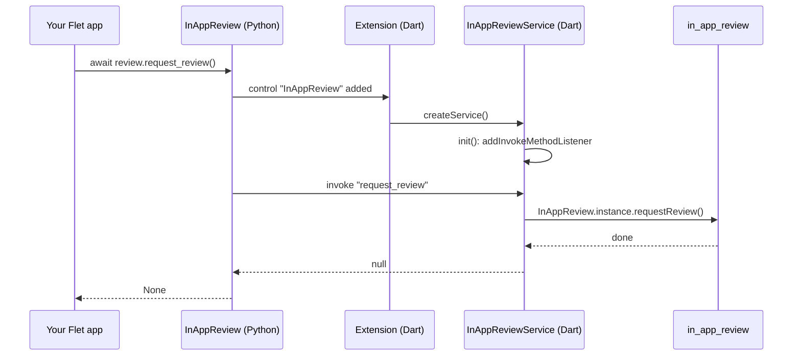

# How it works

`flet-review` is a Flet extension made of two halves that ship in the same
Python package:

- **Python** — `InAppReview` (`src/flet_review/flet_review.py`), a
  `ft.Service` registered as control type `"InAppReview"`.
- **Flutter** — the `flet_review` Dart package
  (`src/flutter/flet_review`), which depends on `flet ^1.0.0` and
  `in_app_review ^2.0.9`.

## Call flow

## Method mapping

| Python method | Invoked name | Plugin call | Returns |
|---|---|---|---|
| `is_available()` | `is_available` | `isAvailable()` | `bool` |
| `request_review()` | `request_review` | `requestReview()` | `None` |
| `open_store_listing(app_store_id)` | `open_store_listing` | `openStoreListing(appStoreId: ...)` | `None` |

Any other method name throws `Exception("Unknown InAppReview method: <name>")`.
When the control is removed, `dispose()` unregisters the listener.
